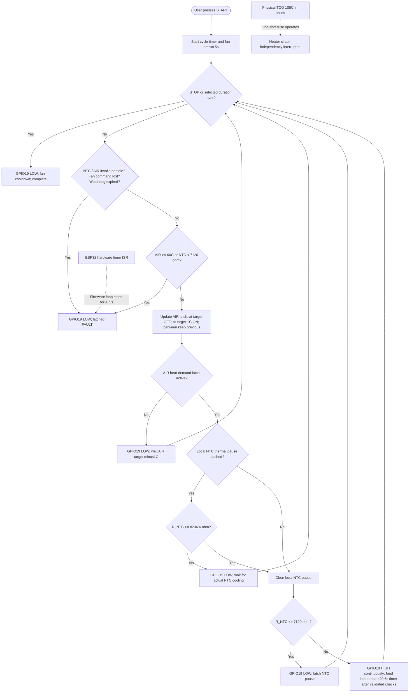

# One priority — safely compare corrected original eBOX Lite fan against 31 October reversed-fan run

**NEW PHYSICAL COMPARISON PROTOCOL, saved before trial — 31 October 2026; new run NOT yet performed.** Operator confirms the original radial fan has been reversed back to OEM orientation and intends to repeat the AIR55/60min session. The previous [original CSV](evidence/thermal/2026-10-31-AIR55-N8580-raw.csv) and [manual Sanwa chronology](evidence/thermal/2026-10-31-AIR55-N8580-PHYSICAL-SESSION.md) show heater continuously commanded ON3594s, AIR max45.84°C (target55 NOT achieved), independent PLATE Sanwa max83°C, embedded NTC min7920.4Ω, no NTC pause and correct timer/cooldown. The blower was mechanically reversed then, so these findings do not qualify the intended OEM airflow. The new comparison changes only fan orientation, to test whether AIR55 and actual thermostat cycling are now attainable under the documented guard. Next gate: physically observed temperature trajectories and separate protection review, never just software CI.

**Source / exact input:** same operator-installed experimental firmware `HOT-261031-N8580` (OLED `H31-8580`), experimental source `1cd96dd76500dfb4d161e1b445d8df6c9d8e524b` [CI#41142714373](https://github.com/alessandrocardelli/filament-dryer-monitor/actions/runs/41142714373). Branch `experiment/step10-heater-diagnostics-air25-2026-10-28`, main heater-OFF. Flash/update firmware NOT required if already showing H31-8580; the CSV itself cannot attest device image. Select user **AIR55°C and duration60min** as previous, fan command100%, prerun5s, cooldown90s. No Noctua conversion, desiccant holder or change to heater limits. Empty filament bay for comparison. Ambient16–17°C was *old run estimate only*; operator should note new ambient (if known).

**Instruments / fixed geometry:** Sanwa RD701/K independent contact on the existing documented near-NTC HEATER PLATE location, same as prior trial; embedded raw-ohm NTC in heater and SHT45 in chamber logged by firmware. Original heater and OEM radial fan; only board is substituted. Operator reports corrected orientation, not yet independently confirmed flow. PWM100% in CSV is command, not independent RPM/current measurement. 105°C one-shot TCO reportedly physically in series; actual continuity/body and nearby insulation must be inspected before heating. Preserve all wiring, protections and sensor locations.

**Mandatory preflight, BEFORE any new HEATER ON:** power unplugged, heater cool; check fan inlet unobstructed and tangential outlet correctly aligned with OEM duct; no wire in impeller, no damaged insulation/heater/TCO wiring or distorted plastics. Verify actual blade operation and airflow direction **with HEATER guaranteed disabled**; the currently installed H31-8580 is heater-capable so do NOT start its normal DRYING cycle to test fan alone. If heater-OFF-only flow test is not safely possible, or the installed TCO, air path, Sanwa contact, wiring or ability to disconnect power is uncertain, STOP and resolve, no heat run. User intent to test is not proof preflight was passed.

**Recording / safety / actions:** existing [live Sanwa Google Sheet](https://docs.google.com/spreadsheets/d/1I5utkzGP1zvD168jLghpYB_y_myGjxMb1ccLens4Cks/edit?gid=525622499): **B old ventola inversa**, **C new correct ventola**, **D notes**, A elapsed. Record C before START, at0:00, each minute1–10, then every2min12–60 on existing beep prompts, without overwriting B. Observe Sanwa continuously, not only at beeps. Local AIR55 OFF / AIR54 rearm, NTC pause<=7120Ω/rearm>=8236.6Ω, NTC below7120Ω FAULT, provisional AIR fault>=60°C, watchdog20.5s, invalid/stale/fan-command STOP and user STOP protections are unchanged and classified in provenance table below. The old 17-Oct NTC7.12kΩ↔Sanwa85°C correlation was open-cover/fanOFF, NOT a safe guarantee with correct fan and box closed. **Manually STOP/cut mains at or before external Sanwa PLATE85°C, or immediately if fan fails/flow changes, unexpected heat, odor, electrical fault or material deformation.** Do not wait for firmware NTC protection if Sanwa hits veto. Note actual AIR target reached / heater OFF, AIR54 restart, NTC pauses, fault, STOP and actual elapsed when observed; do not invent events. Network HTTP may remain inaccessible under continuous HEATER ON.

**After HEATER OFF:** record C at actual OFF+30,+60,+90,+120s, and optional +3,+5min if observed; monitor for post-OFF peak, do not assume it. Download NEW `/api/last-test.csv` only after no heater demand and server responsive, preserve as separate original file; don't overwrite prior archived CSV. Save exact Sanwa chronology, date/time or missing wall clock, exact firmware ID from screen, ambient estimate if known, fault/STOP and postheat results. At session end update single original evidence record, PROJECT_STATE, TODO and ledger in this existing branch; do not assert PASS unless both target/control and physical safety independently established.

## Saved flowchart — HEATER-capable experiment physically tested 31 October; not V1-qualified

**Thermostat latch semantics:** AIR reaching target shuts heat OFF; only AIR <= target−1°C rearms air demand. Local NTC reaching its upper threshold shuts HEATER OFF; only R_NTC >=8.2366kΩ rearms local heat. **Both conditions must allow heating.** A locally hot start (7.12–8.2366kΩ) never bypasses rearm. There is **no 20s software ON window and no minimum OFF time**; hardware watchdog is refreshed on *each validated responsive loop* but physically cuts the GPIO to LOW on stalled code. GPIO may also be forced LOW immediately by STOP, expiry or FAULT. The existing 90s cooling fan behavior is retained.

## Numbers and provenance — do not confuse independent physical sites

| Function | Implemented value | Classification and evidence |
| --- | --- | --- |
| AIR target | User-selectable40..55°C, trial target55°C | USER GOAL; SHT45 actual chamber measurement, not Sanwa |
| AIR rearm | AIR target minus1°C (e.g.55→54) | PROVISIONAL_EXPERIMENT; STEP12P real AIR25/24 thermostat already observed |
| Local NTC stop | R_NTC **<=7,120Ω** | MEASURED_CHARACTERIZATION **Sanwa PLATE85°C paired with embedded NTC7.12kΩ on17 Oct**, OPEN covers/FAN OFF; PROVISIONAL_EXPERIMENT as attended regulator |
| Local NTC rearm | R_NTC **>=8,236.6Ω** | **CALCULATED INTERPOLATION** between measured Sanwa74°C→9.81kΩ and85°C→7.12kΩ, equivalent to Sanwa PLATE80°C in **that old geometry only**. NOT a new physical measurement, not bead calibration |
| Independent latched hot-region fault | R_NTC **<7,120Ω** | PROVISIONAL_EXPERIMENT conservative outside-measured-endpoint guard; a normal post-OFF thermal undershoot can intentionally latch FAULT |
| AIR invalid/hot fault | Fault if invalid/stale or AIR >=60°C | PROVISIONAL_EXPERIMENT, not proven safe material ceiling |
| NTC invalid/stale | Electrical invalid/open, age>1500ms; AIR age>5000ms | ELECTRICAL_AND_PROVISIONAL source safety, independently fail-OFF |
| Fan command | start before heat, 5s prerun, command100%, 90s post-heater cooling | PROVISIONAL_EXPERIMENT; PWM100% does not verify actual rotor rotation |
| User duration | 15min..12h, no cumulative heater ON budget | User cycle timer; physical use of long sessions NOT qualified |
| Repeated20s ON / forced OFF | **REMOVED from currently selected hot controller** | Historical commissioning artefact, demonstrably limited last AIR55 trial |
| Independent hardware fail-OFF | ESP32 ISR timer **20.5s** refreshed by healthy controller loop, not by power-off cycles | ELECTRICAL_OR_HARDWARE implementation; software compile/host invariants required, **physical stalled-loop GPIO verification not yet measured** |
| Installed 105°C TCO | Independent one-shot series fuse, **not bypassed** | ELECTRICAL_OR_HARDWARE user report and assembly; physical body temperature, DC interrupt suitability and assembly material margin still unqualified |
| OEM heater plate roughly118°C | Original OEM historical reference | DIFFERENT assembly/controller; not a certification of modified prototype |

**Crucial historical correction:** Sanwa64°C→13.73kΩ was the *old* too-wide rearm, **not Sanwa74°C**. We have already tested Sanwa85°C→NTC7.12kΩ; do not ask the operator to repeat those seven old points. Current firmware *does not measure Sanwa*: it reads NTC resistance, so **85°C on the actual external Sanwa is not guaranteed** by the proxy, particularly in a changed fan/enclosure geometry. No user was asked to provide a new thermistor catalog part number to proceed with this experimental profile.

## One next engineering gate

**Before any heat:** confirm correct fan airflow heater-OFF only, safe TCO/wiring/mechanical condition and Sanwa/STOP availability as in the protocol above. If not confirmed, defer heat. When checked, operator may run the explicitly supervised same-image AIR55/60min comparison while enforcing Sanwa85°C veto; this is not unattended operation. New thermal behavior might be faster or slower.

**After run:** compare old vs new AIR/NTC CSV and manually paired Sanwa in the same relative-time slots; determine if actual AIR55 cutoff and AIR54 rearm were observed. Retain original raw data, don't change calibrated/provisional limits automatically; evaluate safety and choose a single evidence-backed next action. Dashboard live HTTP and optional Noctua/desiccant ideas remain backlog, not this test.
