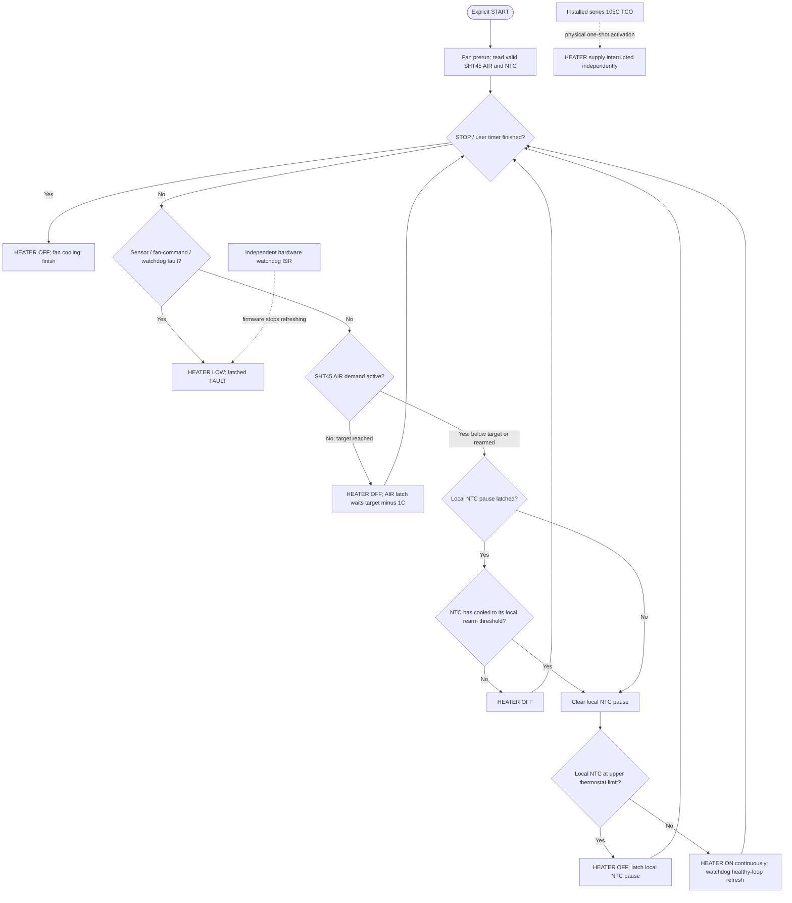

# Next work — one priority

## Fix the real HEATER thermostat, not another 20-second pulse test

**Priority (2026-10-30):** implement a demand-driven regulator in the **existing** experimental branch `experiment/step10-heater-diagnostics-air25-2026-10-28`. No new branch or experimental PR. The present image `HOT-261030-SANWA` is **physically tested but failed to reach AIR55°C in 60min**, not a qualified dryer. The original 850-row [CSV](evidence/thermal/2026-10-30-AIR55-SANWA-raw.csv), every user Sanwa entry and diagnosis are retained in the [complete session](evidence/thermal/2026-10-30-AIR55-SANWA-PHYSICAL-SESSION.md). **Do not repeat that unchanged run.**

**What actually failed:** air last41.12°C/max41.16°C vs user target55°C; external Sanwa plate max69°C, 146 ON fronts, 145 ON windows exactly20s, average OFF gap4.6596s, NTC minimum11.727kΩ (soft9.81kΩ never tripped), zero logged faults. Source `HeaterStep09AirFeedback.h` creates the20s OFF interval and then universally applies an NTC-recovery >=13.73kΩ even without reaching soft pause; **this architecture actively limits heat delivery**. Host/ESP32 CI previously PASS only proved implementation of *the wrong behavior*. Previous STEP12P had already proved AIR25/24 thermostat cut-off/restart; this new run establishes that heat/hold up to55°C still fails.

**Already measured, NOT missing:** [2026-10-17 real Sanwa–NTC characterization](NTC_CALIBRATION_ANALYSIS.md), open covers/fanOFF, near-plate Sanwa30/39/47/56/64/74/**85°C** at NTC64.62/42.27/28.72/19.68/13.73/9.81/**7.12kΩ**. When the Sanwa contact read85°C, the old heating sketch indicated90°C; it was **not** a direct bead temperature measurement. This dataset must be used, not requested again. It does not certify 90°C plate contact under the new closed/fan100 setup or determine TCO-body temperature. The user wants a heater-local NTC thermostat with an independently controlled AIR55 target, without fabricated runtime gaps.

## Approved functional logic — flowchart persisted in GitHub

This is the requested **thermostat control flow**, not the old pulse sequence. The diagram specifies behavior only: no new heater exposure, threshold calibration, physical safety approval or numerical rearm choice is implied. The controller **requests heat continuously** until a real thermostat/fault condition changes; a separately refreshed independent GPIO watchdog remains fail-OFF if the loop stalls.

### Exact meanings and limits — no invented calibration

- **AIR thermostat:** setpoint 55°C -> heat request OFF at AIR55, ON again at AIR54 (assuming local NTC is ready). This 1°C AIR hysteresis is currently implemented and STEP12P demonstrated at AIR25/24.
- **NTC thermostat:** when heater-local upper threshold is reached, heater OFF. Only after real NTC recovery to its **separate lower threshold** can heater ON resume; it must **not** wait for an arbitrary 2s gap or a 20s pulse boundary.
- The **17 Oct measured pairs** were *Sanwa plate-contact* 64°C→13.73kΩ, 74°C→9.81kΩ, **85°C→7.12kΩ**, with both covers open/fanOFF. Previously proposed "rearm13.73kΩ" means about **64°C at that independent Sanwa contact**, not74°C. That would be roughly **21°C drop from the measured85°C contact**, which the operator explicitly rejected. The old 13.73kΩ is **not adopted as the new rearm threshold**.
- **Example for discussion only, NOT a programmed/final limit:** contact upper85°C and lower80°C would be a 5°C band. An interpolation *within* the actually sampled Sanwa74°C/9.81kΩ and85°C/7.12kΩ pairs gives **~8.24kΩ at an interpolated Sanwa80°C**, not a measured bead calibration. Open box/fanOFF transfer does not prove the new enclosed FAN100 temperature, TCO105 body margin or an independent hard-fault threshold. Neither 85/80 nor ~8.24kΩ is selected as an actual safe controller setpoint here.
- **Separate FAULT boundary:** numerical local hard trip must be independently justified, not guessed outside the observed7.12kΩ endpoint. Do not silently equate normal thermostat stop and latched fault.
- **Watchdog:** its independent GPIO timer interrupt must still force the heater OFF on a blocked/unresponsive controller. During valid continuous heat demand, healthy code refreshes its deadline; it does **not** toggle heater OFF just to reset the watchdog. Arduino firmware must never infer actual fan rotation from PWM command.
- **Implementation status:** `firmware/HeaterProductAir.h` and `SafetyController.h` now contain the desired continuous-demand product design, with host simulated NTC Celsius limits. **`AppConfig::kHeaterOutputEnabled=false`, `kHeaterProfileApproved=false` and `kHeaterNtcModelApproved=false`: the new control path is not enabled on physical hardware.** The old `HOT-261030-SANWA` experimental pulse mode remains separate/unchanged, not a recommended new physical test. The user must not repeat the failed AIR55 test unchanged.

### Required design behavior / software verification BEFORE new hot trial

1. When chamber AIR is below selected user target (40..55°C) **and** heater-local NTC demand is below its independently justified thermal limit, command heater ON without a repeating *forced* 20s OFF cycle. Do not merely extend 20s to another arbitrary pulse duration.
2. When heater-local NTC genuinely reaches the established thermostat ceiling, command OFF and **latch thermal pause** until the properly defined lower local threshold/appropriate hysteresis, independently of AIR demand. An NTC-recovery requirement must not be imposed after a synthetic timing boundary when the NTC did not reach its local stop threshold.
3. Separately, when SHT45 chamber AIR reaches user setpoint, switch OFF; rearm at configured AIR hysteresis (currently1°C, physical STEP12P at25/24 previously passed). Stop at user-selected cycle duration; respect manual STOP.
4. **Independent fail-off watchdog** must be deliberately re-engineered and host/fault-tested so stalled MCU or stale controller cannot leave GPIO19 HIGH. Normal continuous demand **must not** defeat or silently remove the hardware interrupt. Preserve sensor-invalid/stale, fan-command loss, overtemperature faults, one-shot TCO and safe cooling. No extra continuous heater enable is authorized by this TODO.
5. Host test: continuous valid demand over several20-second intervals without periodic heater OFF, real NTC-local high/low threshold shut/rearm, AIR55 shut/AIR54 rearm, 60min cycle, STOP, simulated stalled-loop watchdog independent GPIO fail-OFF, sensor/fan fault latches, cooldown, CSV/buzzer unaffected. Rebuild with Arduino IDE-compatible ESP32 core3.3.12 and U8g2 2.36.19 on CI. **Software PASS != physical approval.**
6. Before any higher-exposure physical session, explicitly decide/justify the *actual* NTC temperature-control calibration and thermal envelope with previously obtained measurements and real enclosure/material/TCO105 physical position/limits; do not extrapolate a Sanwa90°C/NTC resistance beyond measured Sanwa85°C/7.12kΩ as if directly verified. The existing 105°C series TCO **must not be bypassed/removed/rerated**, and changing control/fault limits requires the independently documented safety review and operator authorization in AGENTS.

### Current limit provenance (do NOT silently inherit as production)

| Existing value / reference | Provenance | Scope |
| --- | --- | --- |
| AIR user selection40–55°C, requested55°C | **USER OBJECTIVE**; experiment control | Actual goal; 55°C physical target **not yet achieved** |
| AIR rearm target−1°C | **PROVISIONAL_EXPERIMENT**; measured AIR25/24 STEP12P | Preserve for host regression; not material fault threshold |
| AIR independent fault60°C | **PROVISIONAL_EXPERIMENT** | Not verified as safe air/material maximum |
| NTC soft9.81kΩ, rearm13.73kΩ, hard7.12kΩ | **MEASURED_CHARACTERIZATION** raw pairs at Sanwa74/64/85°C open/fanOFF, **PROVISIONAL_EXPERIMENT** as control guards | Local bead Celsius unknown; must distinguish thermostat/overtemperature and geometry before stronger heating |
| Per-ON time20s / ISR20.5s; OFF at least2s | **PROVISIONAL_EXPERIMENT** first-article commissioning + currently tested independent HW GPIO cutoff | Periodic OFF is **known artificial limiter**. Re-architect watchdog without losing fail-OFF |
| Total heater ON cap | **NONE** in currently selected duration-controlled trial | User cycle duration 15min..12h, not heater budget |
| NTC age1500ms, AIR age5000ms, NTC open250kΩ | **PROVISIONAL_EXPERIMENT** fault tests | Keep independently verified faults |
| Fan start5s / command100% | **PROVISIONAL_EXPERIMENT**; observed prior physical fan operation | PWM command is not RPM/airflow proof |
| Postheat fan90s | **PROVISIONAL_EXPERIMENT** | Postheat Sanwa maximum and material margin still unverified |
| Installed independent series TCO105°C | **ELECTRICAL_OR_HARDWARE** per recorded assembly, actual body temperature/DC suitability **UNKNOWN** | No automatic removal/bypass; physically verify before more heating |
| Original OEM plate roughly118°C | Historical **MEASURED_CHARACTERIZATION / source report** of different original controller | Not automatic approval for modified system |
| Sanwa85°C contact / R7.12kΩ | Actual **MEASURED_CHARACTERIZATION** 2026-10-17 open/fanOFF | Upper actually measured reference; not certified limit or 90°C plateau |
| Manual proposed Sanwa abort85°C | **PROVISIONAL_EXPERIMENT**, NOT independently approved safe stop | Stop sooner for abnormalities and keep independent safety safeguards |

### After software correction

One **separately approved**, supervised characterization at a useful AIR target, observing external Sanwa PLATE temperature, raw NTC, SHT45 AIR, actual fan airflow, thermal behavior after irreversible OFF, and original CSV. The 2026-10-30 physical run is already archived; there is no need to re-request its readings. Update this TODO/PROJECT_STATE once its architectural fault is corrected, rather than creating new checkpoint documents.

**Firmware upload method remains Arduino IDE** using the existing experimental branch; `main` remains non-heating, PR#18 DRAFT, and no physical heater test or automatic upload is authorized by documentation changes.
